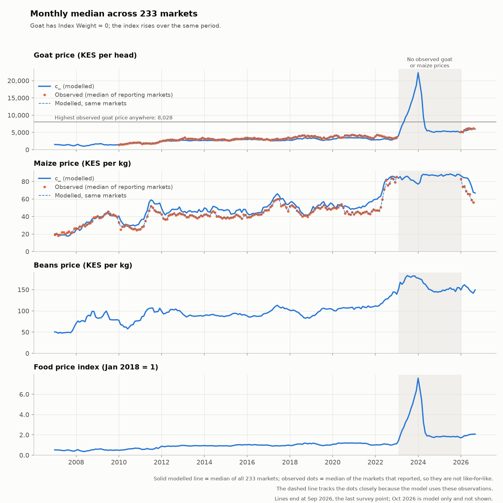
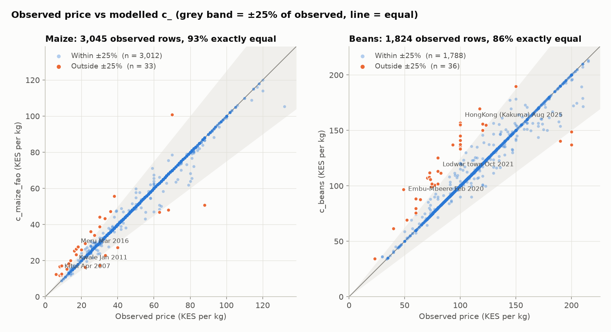
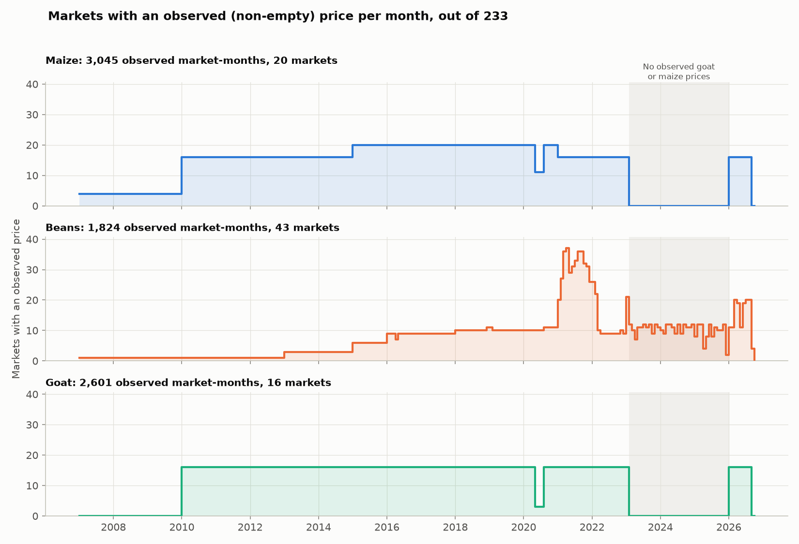

# Kenya market food prices: data audit

An audit of the market-level food price file `KEN_RTFP_mkt_2007_2026-10-05.csv` from the World Bank Microdata Library (233 Kenyan markets, monthly from January 2007 to October 2026), comparing observed prices with the `c_*` price columns.

## The question

How much of this file is observed price data, how closely do the `c_*` columns match the observed prices where both exist, and what do the `c_*` series show in periods with no observations?

## Key findings

All numbers come from [`docs/audit_findings.md`](docs/audit_findings.md), where each one is listed with the command that produced it.

1. **Most market-months have no observed price.** Every one of the 233 markets has all 238 months, but only 49 markets have at least one observed price; 184 never do. The observed price columns are missing in 96.72% of rows (beans), 95.33% (goat) and 94.53% (maize).
2. **Where an observed price exists, `c_*` usually matches it exactly.** Exact matches: 86.2% of observed rows for beans, 93.5% for maize and 93.3% for goat. Correlations: 0.9799, 0.9948 and 0.9951.
3. **There are no observed maize or goat prices from February 2023 to December 2025.** They stop after January 2023, have 0 rows in that period, and resume in January 2026. Beans continue through it (357 observed rows).
4. **During that gap, the median goat `c_` price rises well above any observed goat price.** The highest observed goat price anywhere is 8,028 KES. The cross-market median `c_livestock_goat_s_fao` rises from 3,234 in January 2023 to 22,299 in January 2024, and all 233 markets are above 8,028 in every month from August 2023 to March 2024. From June 2024 to December 2025 the median settles at 5,022–5,532. When observations resume, the observed medians for January to March 2026 (5,224 / 5,132 / 5,650) cover only the 16 markets that reported. The `c_` medians for those same markets are identical; the `c_` medians across all 233 markets (4,920 / 5,142 / 5,518) include the 217 markets that did not report, so they are not like-for-like with the observed medians.
5. **The food price index peaks over the same period.** The cross-market median `c_food_price_index` is 7.58 in January 2024, against 1.13 in January 2023 and 1.83 in June 2025. Over the same three months, median maize goes 85.00 → 76.99 → 87.74 and median beans 139.31 → 177.13 → 150.72. `inflation_*` equals the 12-month % change of `c_*` to within 0.145 percentage points for beans, maize and goat, but differs by up to 10.294 percentage points for the food price index.
6. **Observed maize prices in the reporting markets fell from January to August 2026.** The median observed maize price in the 16 markets that reported fell from 83.0 KES per kg in January 2026 to 56.0 in August 2026. How those markets were chosen isn't documented in the file, so they shouldn't be read as a random sample of Kenyan markets.

## Charts

The shaded period in the first and third charts is February 2023 to December 2025, when there are no observed goat or maize prices.

## What I did not verify

Copied from [`docs/audit_findings.md`](docs/audit_findings.md):

- That `c_*` is a model estimate and the non-empty raw columns are observations: consistent with the details file (`imputation_model`, data coverage of about 4.5%, imputation R-squared values) but not documented in the file itself.
- That the rise in the food price index over the same period may reflect the goat series despite "Index Weight = 0": inferred from the timing in sections 6 and 7 only, not from the index formula.
- That some `adm1_name`/`adm2_name` values (e.g. "Moyale", "Ongata Rongai", "Hola (Tana River)") may not match the administrative level of other entries: based on my knowledge of Kenyan geography, not checked against a boundary file.
- Why `Market Average` sits 7–9% below the simple mean (likely a weighted or geometric mean).
- Whether the close agreement between observed and `c_` prices where both exist reflects accuracy or simply that the model was fitted to those observations: not tested here, since no independent observations were used.

## Reproducing this

1. Download the Kenya market-level files from the World Bank Microdata Library and put them in `data/raw/`:
   - `KEN_RTFP_mkt_2007_2026-10-05.csv`
   - `KEN_RTP_details_mkt_2007_2026-10-05.csv` (used in section 10 of the audit)
2. Install Python 3 with pandas, numpy and matplotlib.
3. Run from the project root, in this order:
   1. `python3 scripts/explore_rtfp.py`: prints the exploratory summaries to the terminal.
   2. `python3 scripts/plot_checks.py`: writes the three charts to `outputs/figures/`.
   3. The commands in [`docs/audit_findings.md`](docs/audit_findings.md): each prints the numbers for its section.

None of these steps modifies the raw data.

## Data attribution

Andrée, B. P. J. (2021). Monthly food price estimates by product and market (Version 2026-10-05). KEN_2021_RTFP_v02_M. Washington, DC: World Bank Microdata Library. https://doi.org/10.48529/2ZH0-JF55 (accessed 20 October 2026)

This analysis is my own and is not endorsed by the World Bank.

## Status

The next phase will use observed prices only.
